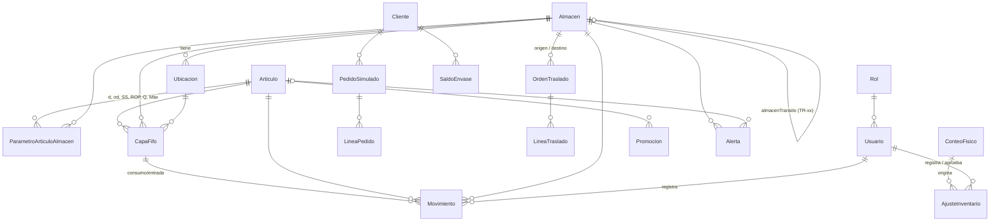

# Modelo de datos — Inventario CBN

Esquema en [backend/prisma/schema.prisma](../backend/prisma/schema.prisma). Convenciones:
- Cantidades en `Int` (cajas o packs).
- Dinero en `Decimal`: precio y costo con 2–4 decimales, valor con 2.
- Las fechas de operación usan la **fecha simulada** (`@db.Date`); `creadoEn` guarda la fecha real.

## Diagrama

`Fiesta`, `ConfiguracionSistema` y `RegistroCambio` son tablas sin relaciones fuertes y no aparecen en el diagrama.

## Tablas

| Tabla | Para qué sirve |
|---|---|
| **Almacen** | Plantas/CD (`PLANTA`) y almacenes de tránsito (`TRANSITO`). Cada planta apunta a su tránsito con `almacenTransitoId`. Guarda el lead time L. |
| **Ubicacion** | PICK-A, PICK-B, ENV-RET, MUELLE-01 y CUAR-01 por planta; EN-RUTA en los tránsitos. `vendible = false` en CUAR-01, ENV-RET y EN-RUTA. |
| **Articulo** | Maestro MD2: precio, vida útil, costo FIFO inicial, si es retornable. |
| **ParametroArticuloAlmacen** | Por artículo y almacén: entradas (d, σd, L, clase, nivel de servicio, Z, días de revisión) y valores calculados (SS, ROP, Q, Máx) más el último conteo. Los calculados salen siempre de `calcularParametros()`. |
| **CapaFifo** | Una capa por cada entrada: lote, fechas, cantidad inicial/restante, costo y estado (DISPONIBLE, CUARENTENA, AGOTADA). El orden FIFO es `fechaEntrada`, luego `id`. Las capas en tránsito llevan `ordenTrasladoId`. Un lote tiene un solo costo y vencimiento (lo comprueba la integridad). |
| **Movimiento** | Libro mayor **inmutable**: un trigger de PostgreSQL rechaza UPDATE y DELETE. La cantidad lleva signo. Los tipos con cantidades físicas (`TIPOS_FISICOS`) son ENTRADA, SALIDA, TRASLADO_*, AJUSTE, MERMA, BONIFICACION y CUARENTENA. CUARENTENA mueve stock entre ubicaciones con dos patas (−n y +n) que suman 0 en el almacén. RESERVA, LIBERACION_RESERVA, CONTEO y ENVASE_* son registros de control. |
| **PedidoSimulado / LineaPedido** | Pedido de demo. Si está `CONFIRMADO`, sus líneas son el **reservado** del almacén. Una línea puede ser `bonificacion` (sin cargo), ligada a una promoción BONIFICACION. Sin stock, el pedido queda `PENDIENTE_REVISION` sin reservas. |
| **OrdenTraslado / LineaTraslado** | Traslado origen → tránsito → destino, con cantidades despachadas y recibidas y el estado de recepción (CONFORME o DANADO). |
| **ConteoFisico** | Conteo cíclico o general por ubicación: sistema vs. contado, diferencia, % y `requiereRecuento` (si supera la tolerancia). |
| **AjusteInventario** | Ajuste o merma con motivo, capa opcional y traslado opcional (`DIFERENCIA_RECEPCION`, sobre el stock en tránsito). R06 lo registra y R07 lo aprueba (PENDIENTE → APROBADO/RECHAZADO), nunca la misma persona. Solo al aprobarse genera movimientos. |
| **Cliente / SaldoEnvase** | Clientes genéricos y envases retornables entregados/devueltos (por cantidad, sin FIFO). |
| **Promocion** | Promociones con tipo, vigencia, tope, cajas usadas y capa opcional (la liquidación aplica a una capa). R02 la propone (PROPUESTA) y R07 la aprueba con `referenciaCorreo` (ACTIVA). Dos promociones ACTIVAS del mismo tipo, artículo y fechas no se solapan. |
| **Fiesta** | Calendario de fiestas: rango, `diasFiesta` reales, zonas (códigos de almacén), factor f y semanas de preparación. |
| **Alerta** | AL01–AL16: clave única mientras está vigente, color, mensaje, roles responsables, acción sugerida, datos (JSON), referencia al registro que la origina, estado (ABIERTA, ATENDIDA, RESUELTA), atención, fecha del color actual y nivel de escalamiento. Ver docs/ALERTAS.md. |
| **HistorialAlerta** | Creación, cambios de color, atención, escalamientos y resolución de cada alerta, con fecha simulada. |
| **EventoIntegracion** | Eventos simulados de integración o conciliación (REINTENTO, COLA_ERRORES, PROCESADO) que alimentan AL16. |
| **Rol / Usuario** | Roles R01…R09 y usuarios genéricos; R06 lleva su almacén asignado. |
| **ConfiguracionSistema** | Clave/valor JSON: fecha simulada, costo por traslado, tasas, tolerancia y umbrales de alertas. |
| **RegistroCambio** | Bitácora de cambios: quién, entidad, campo, valor anterior y nuevo. |

## Cómo se calcula el stock

Por artículo y almacén (ver `backend/src/inventario/stock.ts`):

- **físico** = Σ `cantidadRestante` de las capas DISPONIBLE del almacén
- **reservado** = Σ de las líneas de los pedidos CONFIRMADO
- **disponible** = físico − reservado
- **cuarentena** = Σ de las capas en CUARENTENA
- **en tránsito** = Σ de las capas que están en el almacén de tránsito asociado (TR-xx)
- **posición** = disponible + en tránsito
- **vendible** = capas DISPONIBLE con vida restante de al menos 15 días (`diasMinimosVidaDespacho`) − reservado. Es lo que se puede reservar y despachar.

Invariantes, comprobados por `npm run db:verificar`:
- Σ capas = Σ movimientos físicos = disponible + reservado + cuarentena.
- Para cada capa, Σ de sus movimientos = cantidad restante.
- Ninguna capa tiene cantidad restante negativa.
- Toda capa vence después de su fecha de elaboración.
- Un mismo lote tiene el mismo costo y vencimiento en todas sus capas.

## Motor de inventario

Ver `backend/src/inventario/motor.ts` y `docs/PERMISOS.md`.
- **Transacciones con candado:** cada operación corre en una transacción y primero bloquea (`SELECT … FOR UPDATE`) la fila de `ParametroArticuloAlmacen` de cada artículo y almacén que toca, en orden de id. Así dos peticiones simultáneas no reservan ni despachan el mismo stock. El tránsito hacia un almacén se protege con el candado del almacén destino.
- **Despacho FIFO:** consume la capa más antigua primero y salta las que están en cuarentena o tienen menos de 15 días de vida. Valora cada pieza con el costo de su capa; un despacho puede generar varios movimientos.
- **Traslado:** al despachar, las capas del origen pasan al tránsito del destino conservando lote, costo y vencimiento. Al recibir:
  - la diferencia queda primero como ajuste PENDIENTE (`DIFERENCIA_RECEPCION`) y la mercadería sigue en el tránsito;
  - lo recibido entra al destino (si llegó dañado, a CUAR-01) y la capa nueva conserva `ordenTrasladoId`;
  - si R07 aprueba la diferencia, sale como merma al costo FIFO; si la rechaza, pasa al destino para que R06 la recuente.
- **Ajustes:**
  - una baja consume la capa indicada o, si no se indica, FIFO;
  - un alta crea una capa con el costo, lote y vencimiento de la última capa;
  - no se aprueba una baja que deje menos stock que lo reservado.
- **Cuarentena:** si es parcial, divide la capa (mismo lote, costo, vencimiento y fecha de entrada). Se libera hacia el picking, o se da de baja con un ajuste que lleve el `capaId` de la capa.
- **Eventos:** al confirmar cada operación se emite `inventario.cambio` con `{ articuloId, almacenId, operacion }`, y el motor de alertas reevalúa ese par antes de responder. `alertas.evaluar` dispara una evaluación completa (fecha simulada, integración, umbrales).

## Decisiones

- **Tránsito como almacén de tipo TRANSITO** (TR-LP, TR-CB, TR-SC), con una ubicación EN-RUTA. Así:
  - todo movimiento sigue teniendo almacén y ubicación, como pide la especificación;
  - las capas viajan con su lote, costo y vencimiento, y el FIFO no pierde trazabilidad;
  - el tránsito se suma con la misma consulta que cualquier stock;
  - un traslado son dos movimientos simétricos (TRASLADO_SALIDA en el origen y TRASLADO_ENTRADA en el tránsito). Al recibirse, se repite el par hacia el destino.

  El tránsito pertenece al **destino**: TR-CB contiene lo que va hacia Cochabamba.
- **El reservado no se guarda en las capas.** Sale de los pedidos confirmados; la capa se consume recién al despachar.
- **Fiestas con fechas no contiguas** (16/07 y 06/08; 14/09 y 24/09) se guardan como un rango, más `diasFiesta` con los días reales, que se usan en el pronóstico.
- **Año Nuevo** se fecha el 31/12/2027 – 01/01/2028, que es el próximo desde la fecha simulada.
- **La clase ABC es la misma en los 3 almacenes.** Se calcula con la demanda de La Paz, como en la sección 4.

## Escenario del seed (30/06/2027)

El seed simula 90 días hábiles (lunes a viernes, del 24/02 al 29/06/2027):
- ventas diarias con distribución normal (media d, desviación σd), generadas con semilla fija;
- entradas periódicas cada 5 días hábiles (clases A/B) o 10 (clase C);
- un simulador FIFO que consume capa por capa.

Las entradas se calculan para que las capas que quedan coincidan exactamente con el objetivo. Si algo no cuadra, el seed falla.

Cada capa más nueva tiene +10 días de vida y +1% de costo; la más antigua del ART-10021 cuesta 12.40.

**La Paz:** exactamente la tabla de la sección 12. Reservado: ART-10021 160 (pedidos PS-0001 y PS-0002) y ART-20011 40 (PS-0003).

**Cochabamba** (L = 4; vida restante de la capa más antigua = 60% de la vida útil):

| Artículo | Disponible | Reservado | Tránsito | SS | ROP | Máx | Estado esperado |
|---|---|---|---|---|---|---|---|
| ART-10021 | 640 | 120 | 0 | 60 | 380 | 940 | Normal |
| ART-10022 | 200 | 0 | 0 | 35 | 223 | 552 | AL01 amarillo |
| ART-10035 | 90 | 0 | 210 | 23 | 143 | 353 | Normal (posición 300) + AL08: OT-2027-0001 de SC, despachada el 23/06 (7 días > L + 2) |
| ART-10048 | 200 | 0 | 0 | 14 | 106 | 267 | Normal |
| ART-20011 | 600 | 0 | 0 | 24 | 184 | 464 | AL03 azul + conteo de hoy con −4 (0.67%, ajuste pendiente) |
| ART-10063 | 150 | 0 | 0 | 7 | 59 | 241 | Normal |
| ART-30005 | 200 | 0 | 0 | 9 | 77 | 315 | Normal |

**Santa Cruz** (L = 3):

| Artículo | Disponible | Reservado | SS | ROP | Máx | Estado esperado |
|---|---|---|---|---|---|---|
| ART-10021 | 950 | 140 | 60 | 450 | 1360 | Normal |
| ART-10022 | 500 | 0 | 36 | 264 | 796 | Normal |
| ART-10035 | 300 | 0 | 23 | 170 | 513 | Normal (origen del traslado de 210) |
| ART-10048 | 100 | 0 | 14 | 128 | 394 | AL01 amarillo |
| ART-20011 | 400 | 0 | 24 | 219 | 674 | Normal |
| ART-10063 | 200 | 0 | 7 | 73 | 381 | Normal |
| ART-30005 | 600 | 0 | 9 | 90 | 468 | AL03 azul |

**Otros datos:**
- **Ajustes pendientes:**
  - LP ART-10063, rotura −6, registrado el 28/06: 48 h simuladas, más de 24 h (AL07 amarillo). Con el 29/06 serían exactamente 24 h y no saltaría;
  - CB ART-20011, diferencia de conteo −4, registrado el 30/06.
- **Envases:** 4 clientes en La Paz. Cliente 003 tiene 50 cajas pendientes desde el 15/04 (más de 60 días) y Cliente 002 tiene 60 desde el 20/05 (más de 30 días).
- **ART-10063 en La Paz:** 2 capas, 40 cajas con 12 días de vida (ya no se despacha: < 15 días) y 110 con 25 días.
- **Promoción:** liquidación por vencimiento del ART-10063 en La Paz (30/06–12/07, tope 110 cajas, 30% de descuento), solo sobre la capa de 25 días (15 a 30 días de vida).
- **Último conteo:**
  - clase A: 10/06/2027;
  - clase B: 15/05/2027;
  - clase C: 10/03/2027;
  - LP ART-30005: 27/12/2026 (185 días);
  - CB ART-20011: hoy.

## Alertas del estado base (30/06/2027)

El seed termina evaluando las alertas con el mismo motor de la API. Quedan 19 vigentes:

| Almacén | Alerta | Artículo | Motivo |
|---|---|---|---|
| La Paz | 🟡 AL01 | ART-10022 | posición 240 ≤ ROP 246 (traslado propuesto 496) |
| La Paz | 🔴 AL01 | ART-10035 | posición 20 ≤ SS 23 |
| La Paz | 🔴 AL02 | ART-10048 | quiebre (vendible 0) |
| La Paz | 🔵 AL03 | ART-20011 | 700 > Máx 624 |
| La Paz | 🔴 AL04 | ART-10063 | capa de 40 cajas con 12 días de vida |
| La Paz | 🟡 AL04 | ART-10063 | capa de 110 cajas con 25 días de vida |
| La Paz | 🟡 AL05 | ART-30005 | último conteo hace 185 días (> 180) |
| La Paz | 🟡 AL07 | ART-10063 | rotura −6 pendiente desde hace 48 h |
| La Paz | 🔴 AL10 | ART-10021 | Cliente 003: 50 envases, 76 días |
| La Paz | 🟡 AL10 | ART-10035 | Cliente 002: 60 envases, 41 días |
| La Paz | 🟡 AL14 | ART-10035 | Aniversario de La Paz en 16 días: posición 20 < pronóstico 117 |
| La Paz | 🟡 AL14 | ART-10048 | posición 0 < pronóstico 91 |
| La Paz | 🟡 AL15 | ART-10063 | liquidación: cobertura 5.5 días < 12 días restantes |
| Cochabamba | 🟡 AL01 | ART-10022 | posición 200 ≤ ROP 223 |
| Cochabamba | 🔵 AL03 | ART-20011 | 600 > Máx 464 |
| Cochabamba | 🟡 AL06 | ART-20011 | conteo −4 (0.67%) con ajuste pendiente |
| Cochabamba | 🔴 AL08 | ART-10035 | OT-2027-0001, 7 días en tránsito > L + 2 (6) |
| Santa Cruz | 🟡 AL01 | ART-10048 | posición 100 ≤ ROP 128 |
| Santa Cruz | 🔵 AL03 | ART-30005 | 600 > Máx 468 |
