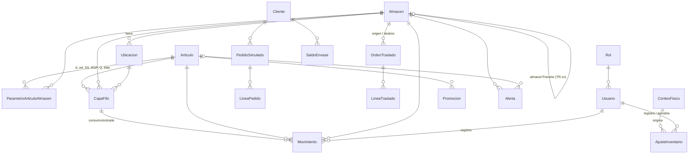

# Modelo de datos — Inventario CBN

Esquema en [backend/prisma/schema.prisma](../backend/prisma/schema.prisma). Convenciones:
- Cantidades en `Int` (cajas o packs).
- Dinero en `Decimal`: precio y costo con 2–4 decimales, valor con 2.
- Las fechas de operación usan la **fecha simulada** (`@db.Date`); `creadoEn` guarda la fecha real.

## Diagrama

`Fiesta`, `ConfiguracionSistema` y `RegistroCambio` son tablas sin relaciones fuertes y no aparecen en el diagrama.

## Tablas

| Tabla | Para qué sirve |
|---|---|
| **Almacen** | Plantas/CD (`PLANTA`) y almacenes de tránsito (`TRANSITO`). Cada planta apunta a su tránsito con `almacenTransitoId`. Guarda el lead time L. |
| **Ubicacion** | PICK-A, PICK-B, ENV-RET, MUELLE-01 y CUAR-01 por planta; EN-RUTA en los tránsitos. `vendible = false` en CUAR-01, ENV-RET y EN-RUTA. |
| **Articulo** | Maestro MD2: precio, vida útil, costo FIFO inicial, si es retornable. |
| **ParametroArticuloAlmacen** | Por artículo y almacén: entradas (d, σd, clase, nivel de servicio, Z, días de revisión) y valores calculados (SS, ROP, Q, Máx) más el último conteo. Los calculados salen siempre de `calcularParametros()`. |
| **CapaFifo** | Una capa por cada entrada: lote, fechas, cantidad inicial/restante, costo y estado (DISPONIBLE, CUARENTENA, AGOTADA). El orden FIFO es `fechaEntrada`, luego `id`. |
| **Movimiento** | Libro mayor **inmutable**: un trigger de PostgreSQL rechaza UPDATE y DELETE. La cantidad lleva signo. Solo ENTRADA, SALIDA, TRASLADO_*, AJUSTE, MERMA y BONIFICACION cambian el stock físico (`TIPOS_FISICOS`). RESERVA, CONTEO, CUARENTENA y ENVASE_* son registros de control. |
| **PedidoSimulado / LineaPedido** | Pedido de demo. Si está `CONFIRMADO`, sus líneas son el **reservado** del almacén. |
| **OrdenTraslado / LineaTraslado** | Traslado origen → tránsito → destino, con cantidades despachadas y recibidas. |
| **ConteoFisico** | Conteo cíclico o general: sistema vs. contado, diferencia y %. |
| **AjusteInventario** | Ajuste o merma con motivo. R06 lo registra y R07 lo aprueba (PENDIENTE → APROBADO/RECHAZADO). Solo al aprobarse genera movimientos. |
| **Cliente / SaldoEnvase** | Clientes genéricos y envases retornables entregados/devueltos (por cantidad, sin FIFO). |
| **Promocion** | Promociones con tipo, vigencia, tope y cajas usadas. |
| **Fiesta** | Calendario de fiestas: rango, `diasFiesta` reales, zonas (códigos de almacén), factor f y semanas de preparación. |
| **Alerta** | AL01–AL16 con color, estado y quién/cuándo/cómo se atendió (sin lógica todavía). |
| **Rol / Usuario** | Roles R01…R09 y usuarios genéricos; R06 lleva su almacén asignado. |
| **ConfiguracionSistema** | Clave/valor JSON: fecha simulada, costo por traslado, tasas, tolerancia y umbrales de alertas. |
| **RegistroCambio** | Bitácora de cambios: quién, entidad, campo, valor anterior y nuevo. |

## Cómo se calcula el stock

Por artículo y almacén (ver `backend/src/inventario/stock.ts`):

- **físico** = Σ `cantidadRestante` de las capas DISPONIBLE del almacén
- **reservado** = Σ de las líneas de los pedidos CONFIRMADO
- **disponible** = físico − reservado
- **cuarentena** = Σ de las capas en CUARENTENA
- **en tránsito** = Σ de las capas que están en el almacén de tránsito asociado (TR-xx)
- **posición** = disponible + en tránsito

Invariantes, comprobados por `npm run db:verificar`:
- Σ capas = Σ movimientos físicos = disponible + reservado + cuarentena.
- Para cada capa, Σ de sus movimientos = cantidad restante.
- Ninguna capa tiene cantidad restante negativa.
- Toda capa vence después de su fecha de elaboración.

## Decisiones

- **Tránsito como almacén de tipo TRANSITO** (TR-LP, TR-CB, TR-SC), con una ubicación EN-RUTA. Así:
  - todo movimiento sigue teniendo almacén y ubicación, como pide la especificación;
  - las capas viajan con su lote, costo y vencimiento, y el FIFO no pierde trazabilidad;
  - el tránsito se suma con la misma consulta que cualquier stock;
  - un traslado son dos movimientos simétricos (TRASLADO_SALIDA en el origen y TRASLADO_ENTRADA en el tránsito). Al recibirse, se repite el par hacia el destino.

  El tránsito pertenece al **destino**: TR-CB contiene lo que va hacia Cochabamba.
- **El reservado no se guarda en las capas.** Sale de los pedidos confirmados; la capa se consume recién al despachar.
- **Fiestas con fechas no contiguas** (16/07 y 06/08; 14/09 y 24/09) se guardan como un rango, más `diasFiesta` con los días reales, que se usan en el pronóstico.
- **Año Nuevo** se fecha el 31/12/2027 – 01/01/2028, que es el próximo desde la fecha simulada.
- **La clase ABC es la misma en los 3 almacenes.** Se calcula con la demanda de La Paz, como en la sección 4.

## Escenario del seed (30/06/2027)

El seed simula 90 días hábiles (lunes a viernes, del 24/02 al 29/06/2027):
- ventas diarias con distribución normal (media d, desviación σd), generadas con semilla fija;
- entradas periódicas cada 5 días hábiles (clases A/B) o 10 (clase C);
- un simulador FIFO que consume capa por capa.

Las entradas se calculan para que las capas que quedan coincidan exactamente con el objetivo. Si algo no cuadra, el seed falla.

Cada capa más nueva tiene +10 días de vida y +1% de costo; la más antigua del ART-10021 cuesta 12.40.

**La Paz:** exactamente la tabla de la sección 12. Reservado: ART-10021 160 (pedidos PS-0001 y PS-0002) y ART-20011 40 (PS-0003).

**Cochabamba** (L = 4; vida restante de la capa más antigua = 60% de la vida útil):

| Artículo | Disponible | Reservado | Tránsito | SS | ROP | Máx | Estado esperado |
|---|---|---|---|---|---|---|---|
| ART-10021 | 640 | 120 | 0 | 60 | 380 | 940 | Normal |
| ART-10022 | 200 | 0 | 0 | 35 | 223 | 552 | AL01 amarillo |
| ART-10035 | 90 | 0 | 210 | 23 | 143 | 353 | Normal (posición 300) + AL08: OT-2027-0001 de SC, despachada el 23/06 (7 días > L + 2) |
| ART-10048 | 200 | 0 | 0 | 14 | 106 | 267 | Normal |
| ART-20011 | 600 | 0 | 0 | 24 | 184 | 464 | AL03 azul + conteo de hoy con −4 (0.67%, ajuste pendiente) |
| ART-10063 | 150 | 0 | 0 | 7 | 59 | 241 | Normal |
| ART-30005 | 200 | 0 | 0 | 9 | 77 | 315 | Normal |

**Santa Cruz** (L = 3):

| Artículo | Disponible | Reservado | SS | ROP | Máx | Estado esperado |
|---|---|---|---|---|---|---|
| ART-10021 | 950 | 140 | 60 | 450 | 1360 | Normal |
| ART-10022 | 500 | 0 | 36 | 264 | 796 | Normal |
| ART-10035 | 300 | 0 | 23 | 170 | 513 | Normal (origen del traslado de 210) |
| ART-10048 | 100 | 0 | 14 | 128 | 394 | AL01 amarillo |
| ART-20011 | 400 | 0 | 24 | 219 | 674 | Normal |
| ART-10063 | 200 | 0 | 7 | 73 | 381 | Normal |
| ART-30005 | 600 | 0 | 9 | 90 | 468 | AL03 azul |

**Otros datos:**
- **Ajustes pendientes:**
  - LP ART-10063, rotura −6, registrado el 29/06 (más de 24 h);
  - CB ART-20011, diferencia de conteo −4, registrado el 30/06.
- **Envases:** 4 clientes en La Paz. Cliente 003 tiene 50 cajas pendientes desde el 15/04 (más de 60 días) y Cliente 002 tiene 60 desde el 20/05 (más de 30 días).
- **Promoción:** liquidación por vencimiento del ART-10063 en La Paz (30/06–12/07, tope 150 cajas, 30% de descuento).
- **Último conteo:**
  - clase A: 10/06/2027;
  - clase B: 15/05/2027;
  - clase C: 10/03/2027;
  - LP ART-30005: 27/12/2026 (185 días);
  - CB ART-20011: hoy.
