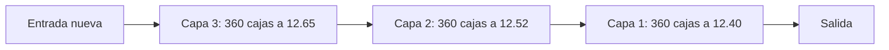
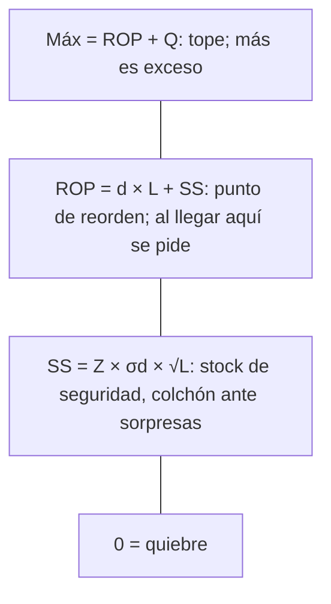

# 01 · El problema y las ideas clave (sin tecnología)

**Qué vas a aprender**
- Qué es un inventario y qué problema tiene CBN con el suyo.
- Las tres ideas que definen el sistema: **mercadería**, **FIFO** y **perpetuo**.
- Los conceptos de reposición: disponible, reservado, tránsito, SS, ROP, Máx, ABC, conteo cíclico, lotes.

## El problema

CBN (Cervecería Boliviana Nacional, de AB InBev) vende cerveza, gaseosa y agua a tiendas por **preventa**:

1. Un preventista visita la tienda y toma el pedido en su celular.
2. Al día siguiente, el camión lo entrega.

El inventario está en tres plantas: La Paz, Cochabamba y Santa Cruz. Hay dos riesgos opuestos:

| Si hay poco stock | Si hay mucho stock |
|-------------------|--------------------|
| El preventista promete algo que no hay → pedido con faltante, cliente molesto | Dinero inmovilizado, cerveza que vence, bodega llena |

El sistema existe para **mantener el equilibrio**: saber en todo momento cuánto hay, cuánto vale y cuándo hay que reponer.

## Las tres ideas: «inventario de tipo mercadería, con algoritmo FIFO y sistema perpetuo»

### 1. Tipo mercadería

**Mercadería** es producto terminado que se vende tal cual, sin transformarlo.
- **Ejemplo cotidiano:** una farmacia vende cajas de paracetamol; no fabrica nada.
- **Con cerveza:** la caja de Paceña ya viene lista de la planta. El sistema **no** maneja malta, botellas vacías para llenar ni repuestos de máquinas (eso es materia prima, producto en proceso o suministros, y queda en AB InBev).

### 2. Algoritmo FIFO (*First In, First Out*: primero en entrar, primero en salir)

- **Ejemplo cotidiano:** la leche del supermercado. El repositor pone la leche nueva **atrás** y la que vence antes **adelante**, para que se venda primero.
- **Con cerveza:** cada entrada de cajas forma una **capa**, con su lote, su costo y su fecha de vencimiento. Al vender se sacan cajas de la capa **más antigua** y se usa **su** costo.

FIFO decide dos cosas a la vez: **qué caja sale físicamente** (la más antigua, que vence antes) y **cuánto costó lo vendido** (el costo de esa capa).

### 3. Sistema perpetuo

- **Ejemplo cotidiano:** tu app del banco. Cada pago descuenta el saldo al instante; no esperas a fin de mes para saber cuánto tienes.
- **Con cerveza:** cada venta, traslado o ajuste actualiza el stock y su costo **en el momento**. Lo contrario es el sistema **periódico**: solo sabes cuánto hay cuando cuentas, a fin de mes.
- **Por qué CBN lo necesita:** el preventista necesita ver el stock real *antes* de prometer, y cada día se confirman unos 2,100 pedidos.

## Los estados del stock

| Estado | Qué es | Analogía |
|--------|--------|----------|
| **Físico** | Las cajas que están en la bodega | Todo el dinero que tienes en la billetera |
| **Reservado** | Cajas prometidas a pedidos confirmados que aún no salieron | Dinero apartado para una compra ya acordada |
| **Disponible** | Físico − reservado | Lo que puedes gastar hoy |
| **Vendible** | Disponible sin contar capas a punto de vencer (< 15 días) ni en cuarentena | Lo que de verdad puedes ofrecer |
| **En tránsito** | Cajas en un camión entre dos plantas | Una transferencia bancaria que aún no llega |
| **Posición** | Disponible + tránsito | Lo que tendrás cuando llegue lo que viene |

## Reponer: ¿cuándo y cuánto?

| Concepto | Pregunta que responde | Ejemplo ART-10021 (Paceña 620 ml) en La Paz |
|----------|-----------------------|----------------------------------------------|
| **d**, demanda diaria | ¿Cuánto se vende por día? | 120 cajas |
| **L**, lead time | ¿Cuántos días tarda en llegar la reposición? | 3 días |
| **SS**, stock de seguridad | ¿Cuánto colchón guardo por si se vende más de lo normal? | 60 cajas |
| **ROP**, punto de reorden | ¿Cuándo pido? | 120 × 3 + 60 = **420** |
| **Q**, lote de traslado | ¿Cuánto pido? | 120 × 7 días de revisión = 840 |
| **Máx** | ¿Hasta dónde lleno? | 420 + 840 = **1,260** |

**Analogía:** el tanque de gasolina.
- El **ROP** es la luz de reserva: cuando se enciende, vas al grifo.
- El **SS** es la gasolina que todavía te queda cuando se enciende la luz.
- El **Máx** es el tanque lleno.

### ¿Por qué reponer es *trasladar* y no *comprar*?

Las compras y la producción las maneja AB InBev. Para CBN-preventa, reponer La Paz significa **traer cajas de Cochabamba o Santa Cruz**. Por eso existe el estado «en tránsito»: la mercadería sale del origen, viaja en un almacén virtual de tránsito y solo entra al destino cuando alguien **confirma la recepción**.

## Clase ABC

No todos los artículos merecen el mismo cuidado. Se ordenan por venta diaria en dólares (precio × d) y se cortan por porcentaje acumulado:

| Clase | Corte | Nivel de servicio (Z) | Conteo cíclico |
|-------|-------|-----------------------|----------------|
| A | hasta 80% | 98% (2.05) | cada mes |
| B | hasta 95% | 95% (1.65) | cada trimestre |
| C | el resto | 90% (1.28) | cada semestre |

**Analogía:** en tu casa cuidas más el celular que los lápices. Los artículos A (Paceña, Paceña lata y Huari) concentran el 74.69% de la venta.

## Conteo cíclico, lotes y vencimientos

- **Conteo cíclico:** en vez de cerrar la bodega una vez al año para contar todo, se cuenta un poco cada semana. Los artículos A se cuentan más seguido. Si el conteo difiere del sistema en más de 0.5%, se genera un **ajuste**, que debe aprobar otra persona.
- **Lote:** el «número de serie» de una producción. Todas las cajas de un lote tienen el mismo costo y la misma fecha de vencimiento.
- **Vencimiento:** no se despacha nada con **menos de 15 días** de vida. Las capas con menos de 30 días encienden una alerta (AL04); las vencidas o dañadas van a **cuarentena** (ubicación CUAR-01).

## Glosario (24 términos)

| Término | Significado corto |
|---------|-------------------|
| Ajuste | Movimiento que corrige el stock (con motivo y aprobación) |
| Alerta | Aviso de semáforo AL01–AL16 sobre un riesgo |
| Almacén de tránsito | Almacén virtual donde vive lo que viaja entre plantas |
| Capa FIFO | Grupo de cajas de una misma entrada: lote, costo, vencimiento |
| Clase ABC | Importancia del artículo según su venta |
| Cobertura | Días que dura el disponible: disponible ÷ d |
| Conteo ciego | Conteo en el que quien cuenta no ve el saldo del sistema |
| Cuarentena | Stock bloqueado (CUAR-01) que no se vende |
| d | Demanda diaria promedio |
| Disponible | Físico − reservado |
| Envase retornable | Botella o caja que el cliente devuelve |
| FIFO | Sale primero lo que entró primero, a su costo |
| Kardex | Historial de movimientos de un artículo con saldo y valor |
| L (lead time) | Días que tarda un traslado en llegar |
| Máx | Stock máximo: ROP + Q |
| Merma | Pérdida por rotura, vencimiento o robo |
| Perpetuo | Stock actualizado en cada movimiento |
| Posición | Disponible + en tránsito |
| Q | Lote de traslado: d × días de revisión |
| Reservado | Prometido a pedidos confirmados |
| ROP | Punto de reorden: d × L + SS |
| SS | Stock de seguridad: Z × σd × √L |
| σd (sigma) | Cuánto varía la demanda de un día a otro |
| Traslado | Movimiento de stock entre plantas (origen → tránsito → destino) |

## Ideas para recordar
- **Mercadería + FIFO + perpetuo:** se vende producto terminado; sale primero lo más antiguo, a su costo; y el stock se actualiza en cada movimiento.
- **Disponible = físico − reservado.** La **posición** suma lo que viene en camino.
- **ROP = d × L + SS:** al llegar a él se traslada hasta el Máx.
- La **clase ABC** decide el nivel de servicio y cada cuánto se cuenta.
- No se despacha con menos de 15 días de vida.

---
Anterior: [← 00 · Cómo usar esta guía](00-como-usar.md) · [Índice](README.md) · Siguiente: [02 · Recorrido práctico →](02-recorrido-practico.md)
