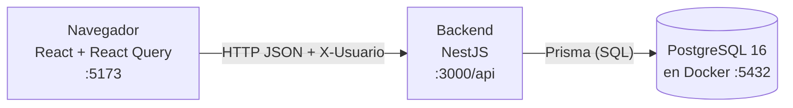

# 03 · Cómo funciona por dentro (arquitectura)

**Qué vas a aprender**
- Para qué sirve cada carpeta del proyecto.
- El viaje completo de «reservar un pedido», desde el clic hasta PostgreSQL y de vuelta.
- Por qué se tomaron las decisiones técnicas principales.

## Tres piezas



- **Frontend (React):** solo **muestra**. No calcula ni un costo.
- **Backend (NestJS):** valida permisos, aplica las reglas de negocio y calcula todo.
- **PostgreSQL:** guarda los datos. Además impone una regla por su cuenta: los movimientos no se pueden modificar.

**NestJS en una línea:** un framework de Node.js que organiza el código en *módulos*. Cada módulo tiene sus *controladores* (reciben las rutas HTTP) y sus *servicios* (la lógica). Entre medio hay *guards*, que deciden si la petición pasa, e *interceptores*, que pueden modificar la respuesta.

**Prisma en una línea:** traduce `tx.capaFifo.findMany({...})` a SQL. El esquema de tablas está en `backend/prisma/schema.prisma`.

## Mapa del proyecto

| Carpeta | Para qué sirve |
|---------|----------------|
| `backend/prisma/` | Esquema de tablas, migraciones (SQL versionado), `seed.ts` y `verificar-integridad.ts` |
| `backend/src/inventario/motor.ts` | Piezas comunes: `bloquear`, `saldo`, `consumir` (FIFO), `registrar`, `emitirCambio` |
| `backend/src/inventario/calculos/formulas.ts` | Fórmulas puras: SS, ROP, Q, Máx, ABC, fiestas, costos |
| `backend/src/inventario/operaciones/` | Una pareja controlador + servicio por operación: pedidos, traslados, conteos, ajustes, cuarentena, envases, promociones… |
| `backend/src/alertas/` | `evaluadores.ts` (reglas puras AL01–AL16), `evaluacion.ts` (ciclo de vida) y `efecto.ts` (interceptor) |
| `backend/src/usuarios/autorizacion.ts` | Guard del encabezado `X-Usuario`, decorador `@Roles` y `exigirAlmacen` |
| `backend/src/simulacion/` | Fecha simulada y configuración |
| `backend/src/analisis/` | Tablero, costos, fiestas, ABC, rotación |
| `backend/src/demo/` | `sembrar.ts` (el seed), escenarios y «Restablecer datos» |
| `backend/test/` | Tests de integración contra la base `inventario_test` |
| `frontend/src/api/` | `cliente.ts` (fetch con `X-Usuario`) y `consultas.ts` (hooks de React Query) |
| `frontend/src/paginas/` | Una carpeta por pantalla |
| `frontend/e2e/` | Pruebas en el navegador: humo, accesibilidad y recorrido |
| `scripts/demo.mjs` | `demo:iniciar` y `demo:detener` |

## El viaje de «reservar un pedido»

```mermaid
sequenceDiagram
  participant U as Usuario (PV-014)
  participant R as React (Pedidos.tsx)
  participant G as UsuarioGuard
  participant C as PedidosController
  participant S as PedidosService.crear
  participant DB as PostgreSQL
  participant A as AlertasService
  participant I as EfectoAlertasInterceptor
  U->>R: clic «Crear pedido y reservar»
  R->>G: POST /api/pedidos (X-Usuario: PV-014)
  G->>DB: busca el usuario; ¿su rol está en @Roles('R01','R07')?
  G->>I: sí, continúa
  I->>DB: foto de alertas vigentes (antes)
  I->>C: crear(dto)
  C->>S: crear(dto, usuario)
  S->>DB: BEGIN; SELECT … FOR UPDATE (bloquear)
  S->>DB: saldo(): capas y reservas → vendible
  S->>DB: INSERT pedido + movimiento RESERVA; COMMIT
  S->>A: emitirCambio → evento inventario.cambio
  A->>DB: evaluarAlertas(par) → crea AL01 si posición ≤ ROP
  S-->>I: pedido
  I->>DB: foto de alertas (después)
  I-->>R: pedido + efectoAlertas {creadas, resueltas, cambiadas}
  R->>R: invalida todas las consultas → la pantalla se actualiza
```

Paso a paso, con los archivos reales:

| # | Dónde | Qué pasa |
|---|-------|----------|
| 1 | `frontend/src/paginas/operaciones/Pedidos.tsx` | `useMutation` llama a `api('/pedidos', { metodo: 'POST', cuerpo })` |
| 2 | `frontend/src/api/cliente.ts` → `api()` | Hace `fetch` con el encabezado `X-Usuario` del usuario elegido |
| 3 | `backend/src/usuarios/autorizacion.ts` → `UsuarioGuard.canActivate` | Sin encabezado → 401; rol no permitido → 403 `SIN_PERMISO` |
| 4 | `backend/src/configurar-app.ts` | `ValidationPipe` valida el cuerpo contra `PedidoDto` (class-validator) y rechaza campos extra (400 con mensajes en español) |
| 5 | `backend/src/inventario/operaciones/pedidos.controller.ts` | `@Post() @Roles('R01', 'R07') crear(...)` |
| 6 | `pedidos.service.ts` → `crear()` | `prisma.$transaction(async (tx) => …, TX)`: `bloquear()`, `saldo()`, crear el pedido y `registrar()` el movimiento RESERVA |
| 7 | `motor.ts` → `emitirCambio()` | Después del COMMIT emite `inventario.cambio` y **espera** a que terminen los oyentes |
| 8 | `alertas/alertas.service.ts` → `@OnEvent(EVENTO_CAMBIO) alCambio` | Llama a `evaluarAlertas(prisma, { pares: [par] })` solo para ese artículo y almacén |
| 9 | `alertas/efecto.ts` → `EfectoAlertasInterceptor` | Compara las alertas de antes y después, y agrega `efectoAlertas` a la respuesta |
| 10 | `frontend/src/main.tsx` | El `MutationCache` invalida todas las consultas: el tablero, la ficha y la campana se refrescan |

En NestJS los guards se ejecutan **antes** que los interceptores: si no tienes permiso, el interceptor ni siquiera saca su foto. El `ValidationPipe` actúa justo antes del controlador. El guard y el interceptor son **globales**: se registran una sola vez en `backend/src/app.module.ts` (`APP_GUARD`, `APP_INTERCEPTOR`). Por eso **todo** POST y PUT responde con su efecto en alertas, sin que cada servicio tenga que hacerlo.

## Por qué está hecho así

| Decisión | Problema que evita | Dónde |
|----------|--------------------|-------|
| **Transacción + `SELECT … FOR UPDATE`** | Dos preventistas venden la misma última caja: los dos leen «quedan 20» y ambos reservan | `motor.ts` → `bloquear()`; la segunda petición **espera** hasta el COMMIT de la primera y lee el saldo ya descontado |
| **Candados en orden de id** | Interbloqueo (*deadlock*): A espera a B y B espera a A | `ORDER BY id FOR UPDATE` en `bloquear()` |
| **Movimientos inmutables con un trigger** | Que alguien «borre» una salida para esconder un faltante | Migración `20261021120000_modelo_datos`: el trigger `movimiento_inmutable` rechaza UPDATE y DELETE en `Movimiento` |
| **Reloj simulado** | Demostrar vencimientos y fiestas sin esperar semanas; resultados repetibles | `simulacion/simulacion.service.ts`; todo «hoy» sale de `fechaOperacion()` |
| **Cálculos solo en el backend** | Que dos pantallas muestren números distintos, o que el navegador mienta | Las fórmulas viven en `formulas.ts`; la ficha muestra lo que llega |
| **Seed determinista** | Que la demo y los tests den números distintos cada vez | `backend/src/demo/sembrar.ts` (sin aleatoriedad real) |
| **Base de pruebas aparte** | Que correr los tests destruya la demo | `backend/test/url-pruebas.ts` usa la base `inventario_test` |

### ¿Qué pasa con dos pedidos simultáneos? (lo comprobamos)

Dos pedidos de 20 cajas de ART-10035 (vendible 20) enviados **a la vez**:

```bash
B='{"cliente":"Cliente 001","almacen":"CD-LP-01","lineas":[{"articulo":"ART-10035","cantidad":20}]}'
for i in 1 2; do curl -s -o /dev/null -w "pedido $i: %{http_code}\n" -X POST \
  -H 'X-Usuario: PV-014' -H 'Content-Type: application/json' -d "$B" localhost:3000/api/pedidos & done; wait
```

Resultado real: `pedido 1: 201` y `pedido 2: 409`. Uno reserva y el otro recibe el faltante. (`curl` hace peticiones HTTP desde la terminal; `&` las lanza en paralelo y `wait` espera a ambas. El reto 4 del [capítulo 08](08-retos.md) lo explica en detalle.)

## Ideas para recordar
- El navegador solo muestra; el backend decide y calcula; PostgreSQL guarda y protege el libro.
- Toda operación que mueve stock sigue el mismo patrón: transacción, `bloquear()`, leer, escribir, COMMIT y `emitirCambio()`.
- El guard global valida quién eres y el interceptor global cuenta qué alertas cambió tu operación.
- El candado de fila convierte «dos a la vez» en «uno después del otro».

---
Anterior: [← 02 · Recorrido práctico](02-recorrido-practico.md) · [Índice](README.md) · Siguiente: [04 · FIFO por dentro →](04-fifo.md)
