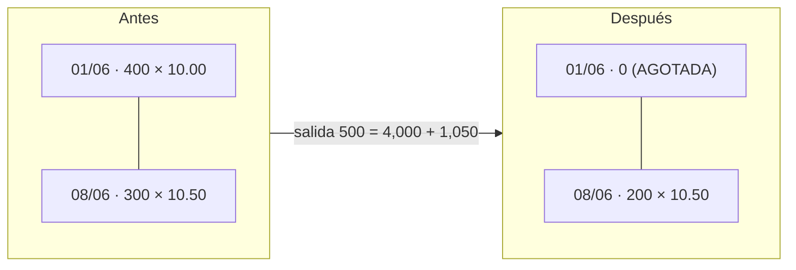

# 04 · El algoritmo FIFO por dentro

**Qué vas a aprender**
- FIFO con un ejemplo pequeño, paso a paso.
- Cómo lo implementa `consumir()` en `backend/src/inventario/motor.ts`.
- Cómo se tratan las capas por vencer, las capas en cuarentena y la división de una capa.
- Por qué FIFO y no LIFO ni costo promedio.

## Ejemplo pequeño (el del documento del sistema, §6.1)

| Fecha | Movimiento | Cajas | Costo | Capas que quedan |
|-------|------------|-------|-------|------------------|
| 01/06 | Entrada | +400 | $10.00 | 400 × $10.00 |
| 08/06 | Entrada | +300 | $10.50 | 400 × $10.00 y 300 × $10.50 |
| 10/06 | Salida | −500 | ? | ? |

Para la salida de 500 se recorren las capas **de la más antigua a la más nueva**:

1. Capa 01/06: tiene 400 y faltan 500. Se toman **400** a $10.00 = $4,000. Faltan 100 y la capa queda **agotada**.
2. Capa 08/06: tiene 300 y faltan 100. Se toman **100** a $10.50 = $1,050. Faltan 0, así que se detiene.
3. Costo de la salida: **$5,050**. Quedan 200 × $10.50 = **$2,100**.



## El mismo mecanismo en el código

`consumir()` en `backend/src/inventario/motor.ts`, recortado:

```ts
const capas = await tx.capaFifo.findMany({
  where: {
    articuloId: o.articuloId, almacenId: o.almacenId,
    cantidadRestante: { gt: 0 },                                     // solo capas con saldo
    ...(o.capaId ? { id: o.capaId } : { estado: 'DISPONIBLE' }),     // sin capa indicada: nada en cuarentena
    ...(o.venceDesde ? { fechaVencimiento: { gte: o.venceDesde } } : {}), // salta las que vencen antes
  },
  orderBy: [{ fechaEntrada: 'asc' }, { id: 'asc' }],                // la más antigua primero = FIFO
});
let pendiente = o.cantidad;
for (const capa of capas) {
  if (pendiente === 0) break;                                       // ya alcanzó
  const n = Math.min(pendiente, capa.cantidadRestante);             // tomo todo lo que pueda de esta capa
  await tx.capaFifo.update({ where: { id: capa.id },
    data: { cantidadRestante: capa.cantidadRestante - n,
            estado: capa.cantidadRestante === n ? 'AGOTADA' : capa.estado } });
  piezas.push({ capa, cantidad: n });                               // «pieza» = cuánto salió de qué capa
  pendiente -= n;
}
if (pendiente > 0) throw new ErrorNegocio(409, 'STOCK_INSUFICIENTE', /* … */);
```

Línea por línea:

| Parte | Qué hace |
|-------|----------|
| `findMany` + `orderBy fechaEntrada asc` | Trae la «cola» de capas con la más antigua primero. El `id` desempata dos entradas del mismo día |
| `estado: 'DISPONIBLE'` | Las capas en `CUARENTENA` o `AGOTADA` no entran en la cola |
| `fechaVencimiento >= venceDesde` | Excluye las capas que vencen antes de *hoy + 15 días* |
| `Math.min(pendiente, cantidadRestante)` | Toma la capa entera, o solo lo que falta |
| `estado: 'AGOTADA'` | Si quedó en 0, se marca agotada (no se borra) |
| `throw … 409` | Si no alcanzó, se lanza un error. Como todo ocurre dentro de una transacción, **se deshace** lo que se hubiera descontado |

Después, el servicio que llamó a `consumir()` (por ejemplo, `PedidosService.despachar()`) registra **un movimiento por pieza**, con el costo de **su** capa:

```ts
movs.push({ tipo: 'SALIDA', capaId: p.capa.id, cantidad: -p.cantidad,
            costoUnitario: p.capa.costoUnitario, /* … */ });
```

y `resumenConsumo(piezas)` arma la respuesta `capasConsumidas` + `costoTotal`, que es lo que ves en pantalla (360 × 12.40 + 240 × 12.52 = USD 7,468.80).

## Tres casos especiales

### 1. Capas con menos de 15 días de vida

`PedidosService.despachar()` llama a `consumir()` con `venceDesde: masDias(fecha, diasMinimos)`. `diasMinimos` es 15 (configuración `diasMinimosVidaDespacho`, política P10). Con fecha 30/06/2027, el límite es el 15/07/2027:

| Capa ART-10063 (La Paz) | Vence | ¿≥ 15/07? | ¿Entra en la cola? |
|-------------------------|-------|-----------|--------------------|
| LP-10063-270113 (40 u., 12 días) | 12/07/2027 | No | ❌ |
| LP-10063-270126 (110 u., 25 días) | 25/07/2027 | Sí | ✅ sale primero |

Por eso, en la práctica 6, 20 cajas salen a 12.93 de la capa de 25 días. El **vendible** (`saldo()`) aplica el mismo filtro: no se ofrece lo que no se puede despachar.

### 2. Capas en cuarentena

Mover a cuarentena cambia la capa a `estado: 'CUARENTENA'` y a la ubicación CUAR-01. Como `consumir()` sin `capaId` exige `DISPONIBLE`, esas cajas **desaparecen de la cola** sin borrarse. Para darlas de baja se registra un ajuste **con su `capaId`**: es el único camino que puede consumir una capa en cuarentena.

### 3. División de una capa

`CuarentenaService.mover()` (`backend/src/inventario/operaciones/cuarentena.service.ts`):

```ts
if (dto.cantidad === actual.cantidadRestante) {
  // toda la capa: se marca CUARENTENA y se mueve a CUAR-01
  enCuarentena = await tx.capaFifo.update({ where: { id: actual.id }, data: { estado: 'CUARENTENA', ubicacionId: cuar.id } });
} else {
  // parcial: la original pierde n cajas…
  await tx.capaFifo.update({ where: { id: actual.id }, data: { cantidadRestante: actual.cantidadRestante - dto.cantidad } });
  // …y nace una capa gemela (mismo lote, costo, vencimiento y fecha de entrada) en CUAR-01
  enCuarentena = await copiarCapa(tx, actual, { /* … */ cantidad: dto.cantidad, fechaEntrada: actual.fechaEntrada, estado: 'CUARENTENA' });
}
```

La gemela conserva la `fechaEntrada`. Así, si se libera, vuelve a la cola **en su lugar original**.

## FIFO frente a LIFO y costo promedio

Con los mismos números (salida de 500 de 400 × $10.00 + 300 × $10.50):

| Método | Costo de la salida | Saldo de 200 cajas | Decisión |
|--------|-------------------:|-------------------:|----------|
| **FIFO** (PEPS) | 400 × 10.00 + 100 × 10.50 = **$5,050.00** | 200 × 10.50 = **$2,100.00** | Usa CBN |
| LIFO (UEPS) | 300 × 10.50 + 200 × 10.00 = $5,150.00 | 200 × 10.00 = $2,000.00 | Prohibido por IFRS/NIIF |
| Promedio ponderado | 500 × (7,150 ÷ 700) = $5,107.14 | 200 × 10.214 = $2,042.86 | No sigue la rotación física |

En el caso real de la práctica 5, LIFO habría dado 360 × 12.65 + 240 × 12.52 = USD 7,558.80, contra USD 7,468.80 con FIFO.

**La razón de fondo:** la cerveza **vence**. Físicamente debe salir primero la más antigua. FIFO hace que el costo siga al producto: lo que sale de la bodega es lo que se cobra al costo de venta.

## Ideas para recordar
- FIFO = recorrer las capas por `fechaEntrada` ascendente y tomar `min(pendiente, saldo)` de cada una.
- Cada pieza consumida se registra con el costo de **su** capa.
- La cola excluye las capas en cuarentena y las que vencen en menos de 15 días.
- Una capa parcial se divide en dos gemelas con la misma fecha de entrada.
- Si no alcanza, la transacción se deshace entera (409).

---
Anterior: [← 03 · Arquitectura](03-arquitectura.md) · [Índice](README.md) · Siguiente: [05 · Fórmulas y reposición →](05-formulas.md)
