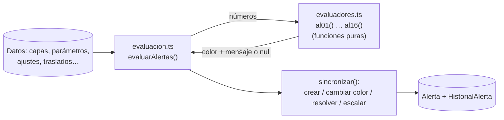
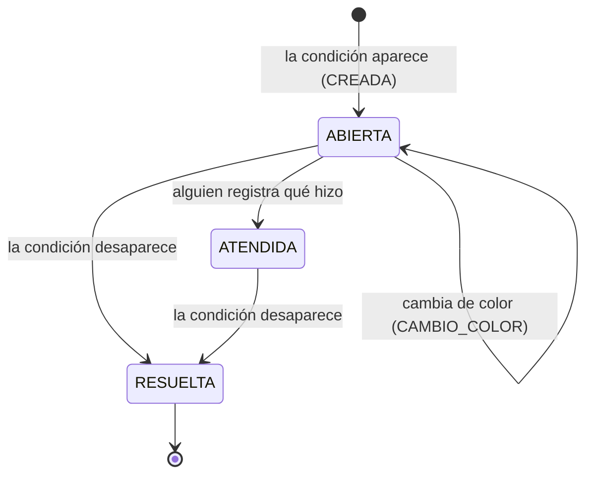

# 06 · El motor de alertas por dentro

**Qué vas a aprender**
- Qué vigila cada alerta, de AL01 a AL16, en lenguaje simple.
- Cómo se evalúan: evaluadores puros, cuándo se disparan y el ciclo de vida.
- El escalamiento y los umbrales editables.
- Una alerta real, desde que nace hasta que se resuelve, vista en la base.

## El catálogo en lenguaje simple

Los colores: 🔴 rojo = actuar ya, 🟡 amarillo = atención, 🔵 azul = informativo (exceso). En la pantalla el color **siempre** va con ícono y texto.

| Alerta | Nombre | Se enciende cuando… | Responsable | Estado base |
|--------|--------|---------------------|-------------|-------------|
| AL01 | Reposición | posición ≤ ROP (🟡) o ≤ SS (🔴) | R07 | 4 |
| AL02 | Quiebre | vendible = 0 (🔴) | R07, R02 | 1 |
| AL03 | Exceso | disponible > Máx (🔵) o > 2 × Máx (🔴) | R07 | 3 |
| AL04 | Vencimiento | una capa tiene ≤ 30 días (🟡) o ≤ 15 (🔴) | R06 | 2 |
| AL05 | Conteo atrasado | pasó la frecuencia de su clase (🟡), y 7 días más (🔴) | R06 | 1 |
| AL06 | Diferencia de conteo | > 0.5% (🟡), > 2% (🔴) | R06, R07 | 1 |
| AL07 | Ajuste pendiente | sin aprobar > 24 h (🟡), > 48 h (🔴) | R07 | 1 |
| AL08 | Traslado sin recepción | en tránsito > L + 1 días (🟡), > L + 2 (🔴) | R06 | 1 |
| AL09 | Diferencia en recepción | hasta 1% (🟡), > 1% o dañado (🔴) | R06, R07 | 0 |
| AL10 | Envases sin devolver | > 30 días (🟡), > 60 (🔴) | R06, R02 | 2 |
| AL11 | Pedido con faltante sin revisar | > 2 h (🟡), > 24 h (🔴) | R03 | 0 |
| AL12 | Reserva sin despacho | > 24 h (🟡), > 48 h (🔴) | R06 | 0 |
| AL13 | Costo atípico en una entrada | > 10% (🟡), > 15% (🔴) frente a la capa anterior | R07 | 0 |
| AL14 | Fiesta con cobertura baja | posición < pronóstico a ≤ 21 días (🟡) o ≤ 7 (🔴) | R07 | 2 |
| AL15 | Promoción sin stock | cobertura < días que le quedan (🟡), vendible 0 (🔴) | R02, R07 | 1 |
| AL16 | Falla de integración | evento en reintento (🟡) o en cola de errores (🔴) | R09 | 0 |

Total del estado base: **19** (5 🔴, 11 🟡, 3 🔵). Detalle completo: [docs/ALERTAS.md](../ALERTAS.md).

## Dos capas: reglas puras + ciclo de vida



**Evaluador puro** = una función que recibe números y devuelve un resultado, sin tocar la base. Por ejemplo, `al01()` en `backend/src/alertas/evaluadores.ts`:

```ts
export function al01(e: { posicion: number; rop: number; ss: number; trasladoPropuesto: number }) {
  const extra = `Traslado propuesto: ${e.trasladoPropuesto}.`;
  if (e.posicion <= e.ss) return res('ROJO', `Posición ${e.posicion} ≤ SS ${e.ss}: reposición urgente. ${extra}`, e);
  if (e.posicion <= e.rop) return res('AMARILLO', `Posición ${e.posicion} ≤ ROP ${e.rop}. ${extra}`, e);
  return null;   // null = no hay alerta
}
```

Al ser pura, se prueba sin base de datos: `backend/src/alertas/evaluadores.spec.ts` revisa cada umbral «justo debajo, en el límite y encima» (20 tests):

```bash
cd backend && npx vitest run src/alertas/evaluadores.spec.ts && cd ..
```

`cd backend` entra en la carpeta; `npx vitest run <archivo>` corre solo ese archivo de pruebas; `cd ..` vuelve a la raíz.

## Cuándo se evalúan

| Disparador | Alcance | Dónde |
|------------|---------|-------|
| Después de cada operación que mueve stock | Solo el par artículo/almacén afectado (y siempre las alertas de documentos: ajustes, traslados, pedidos) | `emitirCambio()` → `@OnEvent(EVENTO_CAMBIO) alCambio` |
| Cambio de fecha simulada, umbrales o eventos de integración | Todas | `EVENTO_EVALUAR` → `@OnEvent(EVENTO_EVALUAR)` |
| Al arrancar el backend | Todas | `AlertasService.onApplicationBootstrap()` |

En el documento hay alertas «en el movimiento», «cada hora» y «cada madrugada» (§7.3). En el prototipo el reloj avanza por días, así que se evalúan en esos tres momentos.

La evaluación toma un candado (`pg_advisory_xact_lock(20270630)`) para que dos operaciones simultáneas no creen la misma alerta dos veces, y es **idempotente**: evaluar dos veces seguidas no cambia nada.

## Ciclo de vida



- Cada alerta tiene una **clave** única, por ejemplo `AL01|2|1|Articulo|1` (código | almacén | artículo | referencia). Si la condición sigue, se actualiza la misma alerta en lugar de crear otra.
- **Atender** guarda quién, cuándo y con qué resultado (RNF07), pero no cierra la alerta.
- **Resolver** es automático. En `sincronizar()`, una alerta vigente que ya no aparece en el cálculo pasa a `RESUELTA` con «condición normalizada».

## Escalamiento

```ts
export const nivelPorHorasEnRojo = (horas: number) => (horas > 48 ? 2 : horas > 24 ? 1 : 0);
```

Una alerta **roja, abierta y sin atender** sube de nivel según las horas que lleva en rojo:

| Nivel | Quién se entera |
|-------|-----------------|
| 0 | El responsable |
| 1 (> 24 h) | R07, Coordinador de logística |
| 2 (> 48 h) | Gerente de Logística y Ventas |

Comprobado: al avanzar la fecha 5 días, el resumen marca `escaladas: 5`. Atender la alerta detiene el escalamiento.

## Umbrales editables

Los valores por defecto están en `UMBRALES_POR_DEFECTO` y los cambios se guardan en la configuración `umbralesAlertas` (con bitácora). Antes de guardar, `validarUmbral()` exige coherencia:

```bash
curl -s -H 'X-Usuario: LOG-01' -H 'Content-Type: application/json' -X PUT \
  localhost:3000/api/alertas/umbrales/AL04 -d '{"valor":{"amarilloDias":10}}'
```

Respuesta real: `UMBRAL_INVALIDO: AL04: el umbral amarillo (10) debe dispararse antes que el rojo (15)`. El amarillo tiene que avisar antes que el rojo. Con `amarilloDias: 100` se crean 7 alertas AL04 nuevas (reto 2 del [capítulo 08](08-retos.md)).

## Una alerta de principio a fin (con datos reales)

1. **Nace:** LOG-01 reserva 600 cajas de ART-10021 en La Paz. La respuesta trae `efectoAlertas.creadas`: AL01 🟡 «Posición 320 ≤ ROP 420. Traslado propuesto: 940.»
2. **En la base:**
   ```sql
   SELECT id, codigo, color, estado, clave FROM "Alerta" WHERE codigo='AL01' ORDER BY id DESC LIMIT 1;
   --  20 | AL01 | AMARILLO | ABIERTA | AL01|2|1|Articulo|1
   ```
3. **Se resuelve:** se cancela el pedido (`POST /api/pedidos/:id/cancelar`) y la reserva se libera. La posición vuelve a 920 > 420, así que `efectoAlertas.resueltas` trae la AL01.
4. **Su historia:**
   ```sql
   SELECT tipo, "colorNuevo", detalle FROM "HistorialAlerta" WHERE "alertaId" = 20 ORDER BY id;
   --  CREADA   | AMARILLO | Posición 320 ≤ ROP 420. Traslado propuesto: 940.
   --  RESUELTA |          | condición normalizada
   ```

(El `id` puede ser otro en tu base; cómo correr estas consultas se explica en el [capítulo 07](07-datos-permisos.md).)

## Ideas para recordar
- Reglas puras en `evaluadores.ts` (fáciles de probar); datos y ciclo de vida en `evaluacion.ts`.
- Se evalúa después de cada operación, al cambiar la fecha o los umbrales, y al arrancar.
- Abierta → (atendida) → resuelta: resolver es automático, atender es humano.
- Una roja sin atender escala a las 24 h y a las 48 h, contadas con la fecha simulada.
- Los umbrales se editan, pero el amarillo siempre avisa antes que el rojo.

---
Anterior: [← 05 · Fórmulas](05-formulas.md) · [Índice](README.md) · Siguiente: [07 · Datos, permisos y seguridad →](07-datos-permisos.md)
