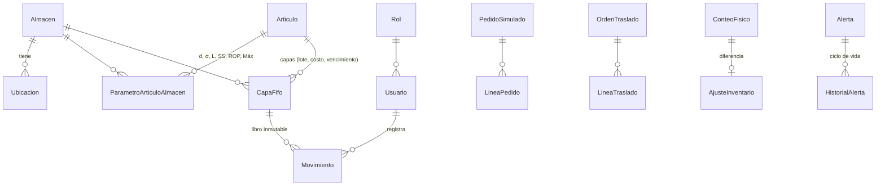
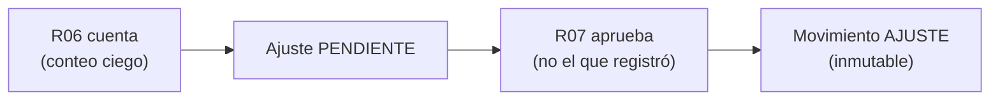

# 07 · Datos, permisos y seguridad

**Qué vas a aprender**
- Las tablas principales y cómo se relacionan.
- A consultar la base con `psql` dentro del contenedor.
- La matriz de roles y la segregación de funciones, y su relación con el control interno del documento.

## El modelo de datos

El esquema completo está en `backend/prisma/schema.prisma`, con 23 tablas de negocio. Las del corazón del inventario:



| Tabla | Qué guarda | Dato clave |
|-------|------------|------------|
| `Almacen` | 3 plantas y 3 almacenes de tránsito | `tipo`: PLANTA o TRANSITO |
| `Ubicacion` | PICK-A, PICK-B, CUAR-01, ENV-RET, MUELLE-01… | `vendible` |
| `Articulo` | Maestro MD2: 7 artículos | precio, vida útil, ¿retornable? |
| `ParametroArticuloAlmacen` | d, σd, L, clase, SS, ROP, Q, Máx por par | Su fila es el **candado** de `bloquear()` |
| `CapaFifo` | Cada entrada: lote, costo, vencimiento, cantidad restante | `estado`: DISPONIBLE, CUARENTENA, AGOTADA |
| `Movimiento` | El libro mayor: cada cambio con tipo, cantidad, costo, valor, usuario y motivo | No admite UPDATE ni DELETE |
| `PedidoSimulado`, `LineaPedido` | Pedidos y sus reservas | `estado`: CONFIRMADO, PENDIENTE_REVISION… |
| `OrdenTraslado`, `LineaTraslado` | Traslados entre plantas | EMITIDA → EN_TRANSITO → RECIBIDA / CON_DIFERENCIA |
| `ConteoFisico`, `AjusteInventario` | Conteos y ajustes pendientes o aprobados | `registradoPorId` ≠ `aprobadoPorId` |
| `SaldoEnvase` | Envases entregados y devueltos por cliente | |
| `Promocion`, `Fiesta` | Promociones con tope y fiestas con factor *f* | |
| `Alerta`, `HistorialAlerta` | Alertas vigentes e historia (creada, color, escalada, resuelta) | `clave` única |
| `ConfiguracionSistema`, `RegistroCambio` | Fecha simulada, umbrales, tasas, y la bitácora de cambios | |

**Dos fuentes que deben coincidir:** el saldo de cada capa (`CapaFifo.cantidadRestante`) y la suma de sus movimientos físicos. Eso comprueba «Verificar integridad».

## Mirar la base con psql

`psql` es el cliente de terminal de PostgreSQL. No necesitas instalarlo: ya viene dentro del contenedor.

```bash
docker exec -it inventario-db psql -U inventario -d inventario_cbn
```

| Parte | Significado |
|-------|-------------|
| `docker exec` | Ejecuta un comando **dentro** de un contenedor que ya está corriendo |
| `-it` | Modo interactivo con terminal (para escribir consultas) |
| `inventario-db` | El nombre del contenedor (definido en `docker-compose.yml`) |
| `psql -U inventario -d inventario_cbn` | Cliente de PostgreSQL con el usuario y la base de `.env` |

Dentro de `psql`:

```sql
\dt                                   -- lista las tablas (24, contando _prisma_migrations)
-- Capas FIFO del ART-10021 en La Paz (almacén id 2), de la más nueva a la más antigua
SELECT lote, "cantidadRestante", "costoUnitario", estado
FROM "CapaFifo" c JOIN "Articulo" a ON a.id = c."articuloId"
WHERE a.codigo = 'ART-10021' AND c."almacenId" = 2 ORDER BY "fechaEntrada" DESC;
-- Movimientos por tipo (estado base: 2,086 SALIDA, 266 ENTRADA, 5 RESERVA…)
SELECT tipo, COUNT(*) FROM "Movimiento" GROUP BY tipo ORDER BY 2 DESC;
-- Alertas vigentes
SELECT codigo, color, estado, mensaje FROM "Alerta" WHERE estado <> 'RESUELTA' ORDER BY codigo;
\q                                    -- salir
```

Los nombres van **entre comillas dobles** porque Prisma crea las tablas y columnas con mayúsculas (`"CapaFifo"`, `"cantidadRestante"`). Sin comillas, PostgreSQL los pasaría a minúsculas y no los encontraría.

**Prueba el trigger** (no rompe nada: es rechazado):

```sql
UPDATE "Movimiento" SET cantidad = 0 WHERE id = 1;
-- ERROR:  Los movimientos de inventario son inmutables (UPDATE no permitido)
```

Ni siquiera alguien con acceso directo a la base puede «arreglar» el libro: la corrección tiene que ser un movimiento nuevo (un ajuste).

## Roles y permisos

Sin contraseñas: el encabezado `X-Usuario` identifica al usuario y el backend valida su rol en **cada** petición. La matriz completa está en [docs/PERMISOS.md](../PERMISOS.md); el resumen:

| Rol | Usuario | Puede | No puede |
|-----|---------|-------|----------|
| R01 Preventista | PV-014 | Ver disponible o agotado y crear pedidos | Ver costos y alertas |
| R02 Supervisor de ventas | SUP-01 | Proponer promociones; ver análisis y fiestas | Aprobar promociones |
| R03 Asistente de pedidos | AST-01 | Consultar; atender AL11 | Mover stock |
| R06 Almacén | ALM-LP / CB / SC | Recibir, despachar, contar, cuarentena y envases **en su almacén** | Aprobar ajustes, liberar cuarentena, operar otro almacén |
| R07 Coordinador de logística | LOG-01 | Aprobar, emitir traslados, editar parámetros y umbrales | Aprobar lo que él mismo registró |
| R08 Gerencia | GER-01 | Ver todo | Escribir |
| R09 Sistemas | TI-01 | Fecha, integridad, restablecer, integración | Operar inventario |

Cuatro errores que verás:
- **401 `NO_AUTENTICADO`:** falta `X-Usuario`.
- **403 `SIN_PERMISO`:** tu rol no tiene esa ruta.
- **403 `ALMACEN_AJENO`:** un R06 intenta operar otro almacén.
- **403 `AUTOAPROBACION`:** apruebas tu propio ajuste.

¿Dónde está cada regla en el código?

| Regla | Código |
|-------|--------|
| Rol por ruta | `@Roles(...)` en cada controlador + `UsuarioGuard` (`backend/src/usuarios/autorizacion.ts`) |
| Almacén propio | `exigirAlmacen(usuario, almacenId)` en cada servicio de almacén |
| No autoaprobar | El servicio de ajustes compara quién registró con quién aprueba |

## Segregación de funciones y control interno

El documento del sistema (§11, «Responsabilidades y control interno») pide responsabilidades delimitadas «para que nadie controle un proceso completo». En el prototipo:



| Componente de control interno (§2) | Cómo aparece |
|------------------------------------|--------------|
| Ambiente de control | Roles definidos y políticas P01–P12 |
| Valoración de riesgos | Riesgos RI1–RI11 vigilados por alertas ([TRAZABILIDAD](../TRAZABILIDAD.md)) |
| Actividades de control | Conteo ciego, aprobación separada, candados, trigger |
| Información y comunicación | Alertas con responsable, bitácora y `efectoAlertas` |
| Monitoreo | Escalamiento, integridad y Pareto de ajustes |

## Ideas para recordar
- `CapaFifo` dice cuánto hay y a qué costo; `Movimiento` dice cómo se llegó ahí. Los dos deben cuadrar.
- `docker exec -it inventario-db psql …` abre la base. Los nombres van entre comillas dobles.
- El trigger hace que el libro sea de solo agregar.
- Rol por ruta, almacén propio y no autoaprobación: tres capas de control.
- Quien cuenta no aprueba; quien registra no aprueba lo suyo.

---
Anterior: [← 06 · Motor de alertas](06-alertas.md) · [Índice](README.md) · Siguiente: [08 · Experimentos y retos →](08-retos.md)
