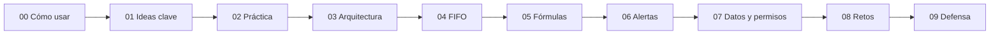

# Guía de aprendizaje · Inventario CBN

Esta guía te lleva, paso a paso, desde «¿qué es un inventario?» hasta poder defender el prototipo frente a un profesor. Cada capítulo dura entre 15 y 30 minutos y se puede leer en VS Code (abre el archivo y presiona **⌘⇧V** para la vista previa) o en GitHub.

| # | Capítulo | Para qué | Tiempo |
|---|----------|----------|--------|
| 00 | [Cómo usar esta guía](00-como-usar.md) | Orden de lectura, levantar y apagar el sistema | 15 min |
| 01 | [El problema y las ideas clave](01-ideas-clave.md) | Inventario, FIFO, perpetuo, ROP… sin tecnología | 30 min |
| 02 | [Recorrido práctico](02-recorrido-practico.md) | 16 prácticas guiadas con los números reales | 30 min |
| 03 | [Arquitectura](03-arquitectura.md) | El viaje de una petición, de un clic a PostgreSQL | 25 min |
| 04 | [FIFO por dentro](04-fifo.md) | Capas, consumo y costo en el código | 20 min |
| 05 | [Fórmulas y reposición](05-formulas.md) | SS, ROP, Q, Máx, ABC y fiestas, calculados a mano | 25 min |
| 06 | [Motor de alertas](06-alertas.md) | AL01–AL16, ciclo de vida y escalamiento | 25 min |
| 07 | [Datos, permisos y seguridad](07-datos-permisos.md) | Tablas, psql, roles y control interno | 25 min |
| 08 | [Experimentos y retos](08-retos.md) | 10 retos para aprender haciendo | 30 min |
| 09 | [Preparación para la defensa](09-defensa.md) | Preguntas, autoexamen y chuleta | 30 min |

**Si solo tienes una hora:** lee 01, haz las prácticas 1 a 5 del capítulo 02 y repasa la chuleta del capítulo 09.

Otros documentos del proyecto: [README](../../README.md), [guion de la demo](../GUION_DEMO.md), [trazabilidad](../TRAZABILIDAD.md), [especificación](../ESPECIFICACION.md).
